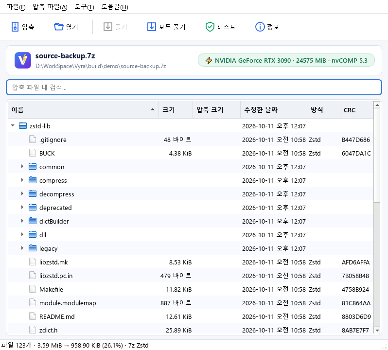
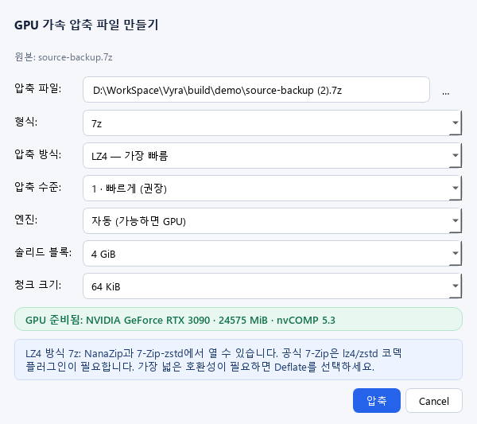

# Vyra

**NVIDIA nvCOMP 기반 GPU 가속 압축 프로그램.** 7z / zip 압축 파일과 .gz / .lz4 파일을 GPU(또는 CPU 전체 코어)로 만들고, 결과물은 **표준 형식 그대로**라서 다른 PC에서도 7-Zip·Windows 탐색기·gzip 등으로 바로 풀 수 있습니다. UI는 [LMDB Archiver](https://github.com/embistel/LMDBArchiver)와 같은 Qt Widgets 스타일이며, 7-Zip처럼 탐색기 오른쪽 클릭 메뉴와 통합됩니다.

[English](README.md)



## 주요 기능

- **GPU·CPU 엔진**: GPU의 nvCOMP 5.3과 전 코어 CPU(zlib-ng / LZ4 / Zstd)가 같은 형식(Deflate · LZ4 · Zstd, 64 KiB 청크 단위)을 만들고, *자동*이 그 PC와 데이터에 더 빠른 쪽을 고릅니다. GPU가 없으면 모두 CPU로 처리합니다.
- **표준 형식 출력**
  | 만든 형식 | 열 수 있는 프로그램 |
  |---|---|
  | `.zip` (Deflate / 저장) | Windows 탐색기, 7-Zip, 반디집 등 모든 ZIP 프로그램 |
  | `.7z` Deflate / 저장 | **공식 7-Zip**, NanaZip 등 |
  | `.7z` LZ4 / Zstd | NanaZip, 7-Zip-zstd, 공식 7-Zip + [코덱 플러그인](https://github.com/mcmilk/7-Zip-zstd/releases)(`Codecs\lz4.dll`, `zstd.dll`) |
  | `.gz` (gzip, 파일마다 하나) | 7-Zip, 반디집, WinRAR, gzip과 모든 Unix 도구, Python |
  | `.lz4` (LZ4 프레임, 파일마다 하나) | `lz4` 도구, 7-Zip-zstd, NanaZip, python-lz4 |

  > 공식 7-Zip은 LZ4/Zstd 방식을 기본 내장하지 않습니다. "어느 PC에서나 7-Zip으로" 풀려야 한다면 **7z + Deflate**, **zip** 또는 **gz**를 고르세요 (압축 대화상자에 호환성 안내가 표시됩니다). 코덱 플러그인은 `.7z` 안의 LZ4/Zstd만 추가하므로, 단독 `.lz4` 파일은 7-Zip-zstd, NanaZip, `lz4` 도구로 엽니다.
- **해제/테스트**: Vyra가 만든 파일뿐 아니라 일반 7-Zip 압축 파일(LZMA, LZMA2, BCJ, 압축된 헤더), 일반 ZIP(Deflate, Zstd), 모든 gzip 파일(여러 멤버, `.tgz` → `.tar`), 모든 LZ4 프레임 파일(연결 블록, 블록/콘텐츠 체크섬)도 풀 수 있습니다. LZ4/Zstd는 블록 단위 병렬(GPU 또는 CPU)로 풉니다. 모든 CRC와 체크섬을 검증합니다. Vyra가 만든 `.lz4`에는 체크섬이 없으므로(`lz4 --no-frame-crc`와 같음) 테스트는 기록된 크기대로 풀리는지를 확인합니다.
- **탐색기 통합 (관리자 권한 불필요)**: 파일·폴더 우클릭 → *Vyra ▸ 압축하기… / 7z로 빠르게 압축 (GPU) / ZIP으로 압축 / 각 파일을 .gz로 압축 / 각 파일을 .lz4로 압축*, `.7z`·`.zip`·`.gz`·`.tgz`·`.lz4` 우클릭 → *Vyra 압축 풀기 ▸ Vyra로 열기 / 여기에 풀기 / 폴더를 만들어 풀기 / 압축 풀기… / 테스트*. 여러 파일을 선택해도 하나의 압축 파일로 묶고, gz / lz4는 파일마다 옆에 `<파일>.gz` / `<파일>.lz4`를 만듭니다(폴더는 안의 모든 파일, 원본 유지). 같은 `Vyra.exe`의 이전 버전이 설치한 메뉴는 다음 실행 때 자동으로 갱신됩니다. Vyra를 다른 폴더로 옮겼다면 *도구 ▸ Windows 탐색기 통합*에서 갱신하세요.
- **스마트 "여기에 풀기"**: 최상위 항목이 하나면 그 자리에, 여러 개면 압축 파일 이름의 폴더를 만들어 풉니다.
- 드래그 앤 드롭(넣으면 압축/열기, 끌어내면 추출), 진행률 창(속도·남은 시간·압축률·엔진), 한국어/영어 UI, CLI(`vyra-cli`).



## 동작 원리

```text
파일 읽기(복사 / 매핑, 높은 우선순위) ─▶ 배치 ─▶ CPU: 청크마다 CRC32 + 압축 (모든 코어)
                                              └▶ GPU: 업로드 → nvCOMP → CRC32·프레이밍·패킹도 GPU에서 ─▶ 순서대로 직접 I/O 기록
```

- **엔진 선택**: *자동*은 입력 앞부분 1 MiB를 CPU 1스레드로 압축해 전체 코어의 처리량을 추정합니다. 코어가 많은 CPU에서는 빠른 코덱(LZ4, Zstd, Deflate 수준 1)이 PCIe를 오가는 GPU보다 CPU에서 더 빠르고, 그렇지 않으면 GPU 경로를 씁니다. GPU를 쓸 때는 CUDA 시작(약 0.5초) 동안 CPU가 먼저 압축합니다(하이브리드). 256 MiB 미만 작업은 항상 CPU로 처리합니다.
- **GPU 경로**: CUDA 스트림 3개(업로드·압축·다운로드)에 배치 최대 4개를 동시에 흘립니다. CRC32, Deflate 결합, LZ4 프레이밍, 패킹을 GPU에서 끝내고 결과를 page-locked 호스트 메모리에 바로 씁니다.
- **입출력**: 아카이브는 직접 I/O(쓰기 4개 동시)로 기록합니다. 큰 입력 파일은 일부는 메모리 매핑, 일부는 파일 캐시 복사로 읽습니다. 둘을 섞는 편이 한쪽만 쓰는 것보다 빠릅니다.

- **Deflate (zip / 7z)**: nvCOMP는 64 KiB 청크마다 `BFINAL=1`인 완결된 Deflate 스트림을 냅니다. Vyra는 각 청크의 마지막 블록 끝 비트 위치를 찾아 `BFINAL`을 지우고 빈 stored 블록(sync-flush 마커, `00 00 FF FF`)으로 바이트 정렬해 이어 붙입니다. 결과는 **하나의 정상적인 Deflate 스트림**이라 어떤 압축 해제기도 그대로 풉니다 (pigz와 같은 방식).
- **LZ4 (7z)**: nvCOMP가 만든 raw LZ4 블록을 표준 **LZ4 Frame**(독립 블록, 64 KiB 블록)으로 감쌉니다. 압축이 안 되는 블록은 비압축 블록으로 저장합니다.
- **Zstd (7z)**: 청크마다 완결된 Zstd 프레임이 이어진 스트림(Zstd 표준이 허용하는 다중 프레임)입니다.
- 7z 메서드 ID는 7-Zip-zstd가 등록한 값(LZ4 `04F71104`, Zstd `04F71101`)을 사용합니다.
- 큰 입력은 솔리드 블록(기본 4 GiB) 단위로 나눠 7z 폴더를 만들고, zip은 ZIP64를 자동 사용합니다.
- **gz / lz4 파일**은 파일 하나씩을 담아 원본 옆에 씁니다(`gzip -k`처럼). 출력이 이미 있거나 이미 `.gz`/`.tgz`/`.lz4`인 파일은 경고 후 건너뜁니다. `.gz`는 gzip 멤버 하나입니다: 이름(ASCII 이름일 때)과 시각, 64비트 원본 크기를 담은 extra 필드 `Vy`가 있는 헤더, 결합된 Deflate 스트림, CRC32와 크기. `.lz4`는 독립 블록과 콘텐츠 크기를 담은 LZ4 프레임 하나입니다.

## 성능 (v0.2 실측)

테스트 PC: Xeon E5-2698 v3 2개(32코어, 2014년, 메모리 채널 3개만 장착), RTX 3090 (PCIe 3.0 x16), WD SN770 NVMe SSD, Windows 10.
방법: 모든 도구가 같은 입력을 파일 캐시에서 읽어 NVMe SSD에 실제 아카이브를 씁니다. 시간은 명령 전체(프로세스 시작부터 종료까지)이며, 5라운드 교차 실행의 중앙값입니다(`7z.exe`와 `vyra-cli.exe`를 번갈아 실행해 같은 배경 부하를 받음).

**4.0 GiB 단일 파일** (Qt `.lib` 파일을 이어 붙인 것)

| 도구 / 설정 | 시간 | 속도 | 압축 후 크기 | 7-Zip 최고속 대비 |
|---|---|---|---|---|
| 7-Zip 26.02 `7z -mx1` (가장 빠른 설정, 32스레드) | 6.81 s | 0.58 GiB/s | 12.2% | 1배 |
| **Vyra `.7z` (기본: LZ4)** | **1.31 s** | **3.01 GiB/s** | 27.6% | **5.2배** |
| Vyra `.7z` Zstd | 1.35 s | 2.92 GiB/s | 18.2% | 5.0배 |
| Vyra `.zip` (Deflate) | 1.48 s | 2.68 GiB/s | 24.4% | 4.6배 |
| Vyra `.7z` LZ4, GPU 강제(`--gpu`) | 1.76 s | 2.24 GiB/s | 28.9% | 3.9배 |

같은 파일에서 7-Zip의 다른 설정(1회 측정): `7z` 기본값(LZMA2 -mx5) 97.6초, `zip -mx1` 80.0초(파일 하나는 스레드 하나로 압축), `zip` 기본값 550초. 이들과 비교하면 Vyra가 50–70배 빠릅니다.

**파일 4,043개, 2.0 GiB 폴더** (Qt `lib` 폴더, 캐시에 있는 상태): 7-Zip `7z -mx1` 7.03초, Vyra `.7z` LZ4 1.25초(**5.6배**), Zstd 1.12초(6.3배), `.zip` 1.48초(4.8배).

- **어느 엔진이 일하나?** 이 32코어 PC에서는 *자동*이 이 코덱들에 CPU 경로를 고릅니다. 새 프로세스에서 GPU 경로는 CUDA 시작에 약 0.45초를 먼저 쓰고, 모든 데이터가 PCIe 3.0을 두 번 지나기 때문입니다. GPU 엔진 단독으로는 여기서 2.4–2.9 GiB/s(데워진 상태, 출력 버림)를 냅니다. 코어가 적은 CPU에서는 GPU가 더 빠르고, 그 경우 자동이 GPU를 고릅니다(CUDA 시작 동안에는 CPU가 먼저 압축).
- 속도는 코덱만큼 입출력 경로에서 나옵니다: 아카이브 직접 I/O 기록(캐시 경유 0.85 GB/s 대비 2.6 GB/s), 입력은 일부 메모리 매핑·일부 복사로 높은 우선순위 스레드가 읽기, CRC32를 압축과 같은 패스에서 계산, 종료 시 정리 생략.
- 압축 후 크기는 7-Zip LZMA2보다 큽니다(27.6% / 18.2% 대 12.2%). 속도를 위해 압축률을 양보한 설계입니다. 같은 속도로 더 작게 만들려면 Zstd를 쓰세요.
- 같은 PC의 다른 프로그램 부하가 있는 상태에서 측정했습니다. 기본 설정의 라운드별 배율은 4.7–5.6배였습니다.

**gz와 lz4, 4.45 GiB 단일 파일** (위 파일 + 그 앞 512 MiB, gzip 크기 필드가 4 GiB를 넘어 한 바퀴 돎. 각 2회, 7-Zip은 1회):

| 도구 / 설정 | 시간 | 속도 | 압축 후 크기 |
|---|---|---|---|
| 7-Zip 26.02 `7z a -tgzip -mx1` (7-Zip의 gzip은 단일 스레드) | 99.95 s | 0.045 GiB/s | 17.8% |
| **Vyra `.gz`** (자동 → CPU) | **2.04–2.32 s** | **1.9–2.2 GiB/s** | 24.8% |
| Vyra `.gz`, GPU 강제 | 3.53–4.31 s | 1.0–1.3 GiB/s | 25.1–25.2% |
| **Vyra `.lz4`** (자동 → CPU) | **1.69–1.75 s** | **2.5–2.6 GiB/s** | 28.1% |

Vyra의 gzip은 7-Zip보다 **43–49배** 빠릅니다. 7-Zip은 더 느린 Deflate 탐색으로 더 작게 만듭니다. 풀 때는 `.gz`는 직렬로 약 550 MiB/s(gzip에는 블록 색인이 없음), `.lz4`는 병렬로 해제 약 2.5 GiB/s, 파일로 풀기 약 1.4 GiB/s입니다.

## 사용법

### GUI
`Vyra.exe` 실행 → 파일/폴더를 끌어다 놓거나 **압축**. 압축 파일을 끌어다 놓거나 **열기**로 내용을 보고 풀 수 있습니다. 탐색기 메뉴는 **도구 ▸ Windows 탐색기 통합...** 에서 설치/갱신/제거합니다 (Windows 11은 "더 많은 옵션 표시" 아래).

### CLI
```powershell
vyra-cli a backup.7z D:\Photos D:\Docs          # 7z + LZ4 (GPU)
vyra-cli a backup.7z D:\Data -m zstd             # 7z + Zstd
vyra-cli a share.zip D:\Data                     # zip + Deflate (어디서나 열림)
vyra-cli a backup.7z D:\Data -m deflate          # 공식 7-Zip 호환 7z
vyra-cli gz D:\Logs                              # 모든 파일 -> 옆에 file.gz (gzip -k -r)
vyra-cli lz4 D:\Dumps\big.bin                    # -> big.bin.lz4
vyra-cli a data.tar.gz data.tar                  # 파일 하나를 지정한 .gz / .tgz / .lz4로
vyra-cli x backup.7z -o D:\Restore               # 풀기 (일부만: 경로 나열)
vyra-cli t backup.7z                             # 무결성 테스트
vyra-cli l backup.7z                             # 목록
vyra-cli info                                    # GPU 상태
vyra-cli bench D:\Data                           # 디스크 제외 처리량 측정
```
옵션: `-m lz4|zstd|deflate|store`, `-l 0-5`, `--gpu`/`--cpu`, `--chunk 64k`, `--batch 64m`, `--solid 4g|off`, `-t <스레드>`, `--keep`(기존 파일 유지).

## 빌드

필요: Visual Studio 2022 (C++), CUDA Toolkit 12.x/13.x, Qt 6.5+ (`msvc2022_64`), Python 3 (nvCOMP 설치·테스트용), CMake 3.24+. NVIDIA GPU는 Volta(7.0) 이상.

```powershell
.\scripts\build.ps1 -InstallDependencies -Test   # nvCOMP 5.3을 .deps에 설치하고 빌드 + 테스트
.\scripts\build.ps1 -Test                        # 이후 빌드
.\scripts\build.ps1 -NoCuda -Test                # GPU 없이 CPU 전용 빌드
.\scripts\package.ps1                            # out\Vyra-<버전>-win64.zip (Qt, nvCOMP, VC 런타임 포함)
```

zlib-ng · LZ4 · Zstandard · LZMA SDK는 CMake가 자동으로 받아 정적으로 링크합니다. `nvcomp64_5.dll`은 지연 로드되므로 DLL이나 NVIDIA 드라이버가 없어도 프로그램은 CPU 모드로 실행됩니다.

테스트: `vyra_tests`(형식 × 방식 × CPU / GPU / CPU+GPU 혼합 × 배치 크기 왕복, gz / lz4 파일별 출력과 건너뛰기 규칙, 이어 붙인 gzip, GPU 프레이밍과 Deflate 끝 비트 빠른 경로 교차 검증, Deflate 결합, 경로 안전성, 취소)와 `interop_test.py`(Python zipfile / gzip / tarfile, 표준 라이브러리만 쓰는 엄격한 LZ4 프레임 디코더, 공식 7-Zip과 양방향 호환). 자세한 구조는 [docs/DEVELOPMENT.md](docs/DEVELOPMENT.md).

## 로드맵

- GPU 엔진: 작업 사이에 CUDA 컨텍스트와 버퍼 유지(한 번 실행하는 작업에서 GPU의 가장 큰 불리함은 시작 비용), page-lock 비용 없이 큰 배치
- **Intel / AMD 내장 그래픽 가속**: `Backend` 인터페이스에 Vulkan compute 또는 oneAPI/OpenCL 백엔드 추가
- MSI 설치 프로그램(WiX, LMDB Archiver와 동일한 구성), Windows 11 최상위 메뉴(IExplorerCommand)
- Vyra가 만든 Deflate 압축과 `.gz`의 GPU 병렬 해제(청크 인덱스), 압축 파일 편집(추가/삭제), 암호화(AES-256), 분할 압축
- `.lz4` 콘텐츠 체크섬 옵션(순차 xxHash 계산 필요)

## 라이선스

Vyra는 MIT 라이선스입니다. 함께 배포되는 서드파티 구성 요소(특히 NVIDIA nvCOMP 바이너리는 NVIDIA 라이선스)는 [THIRD_PARTY_NOTICES.md](THIRD_PARTY_NOTICES.md)를 참고하세요.
