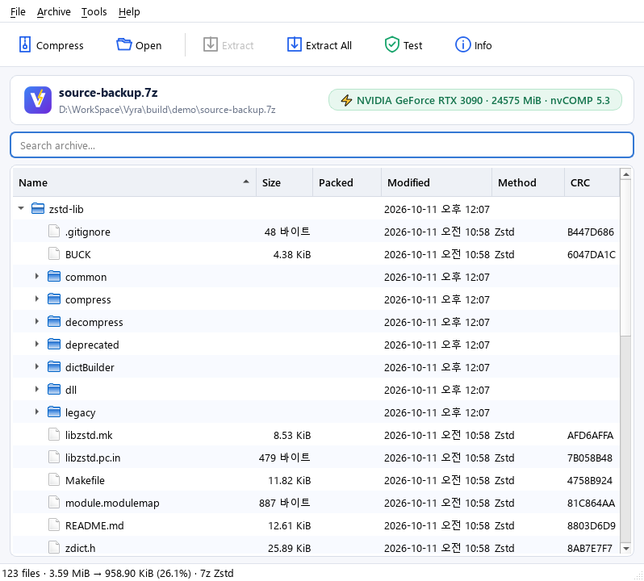
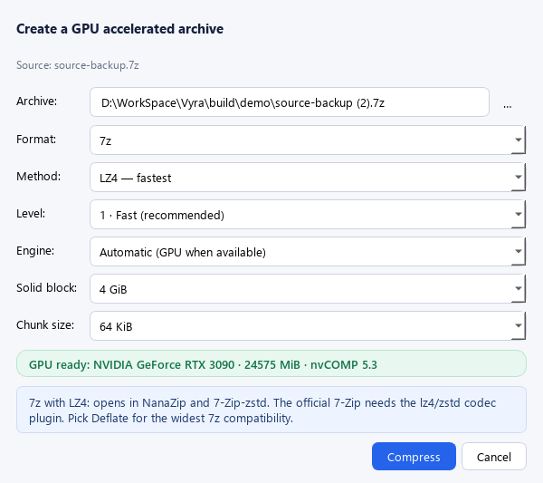

# Vyra

**GPU accelerated archiver built on NVIDIA nvCOMP.** Vyra creates 7z and zip archives and .gz / .lz4 files on the GPU (or on all CPU cores) while keeping the output in **standard formats**, so other PCs open them with 7-Zip, Windows Explorer, gzip and friends. The UI follows [LMDB Archiver](https://github.com/embistel/LMDBArchiver) (Qt Widgets), and it integrates with the Explorer context menu like 7-Zip.

[한국어](README.ko.md)



## Features

- **GPU and CPU engines**: nvCOMP 5.3 on the GPU and zlib-ng / LZ4 / Zstd on all CPU cores produce the same formats (Deflate, LZ4, Zstd in batches of 64 KiB chunks); *Auto* picks the faster one for the machine and the data. Without a GPU everything runs on the CPU.
- **Standard output**
  | Created as | Opens in |
  |---|---|
  | `.zip` (Deflate / Store) | Windows Explorer, 7-Zip, any unzip tool |
  | `.7z` Deflate / Store | **official 7-Zip**, NanaZip, … |
  | `.7z` LZ4 / Zstd | NanaZip, 7-Zip-zstd, official 7-Zip + [codec plugins](https://github.com/mcmilk/7-Zip-zstd/releases) (`Codecs\lz4.dll`, `zstd.dll`) |
  | `.gz` (gzip, one file each) | 7-Zip, WinRAR, gzip and every Unix tool, Python |
  | `.lz4` (LZ4 frame, one file each) | the `lz4` tool, 7-Zip-zstd, NanaZip, python-lz4 |

  > The official 7-Zip has no built-in LZ4/Zstd. When "any PC with 7-Zip" must open the archive, choose **7z + Deflate**, **zip** or **gz** (the compress dialog explains this). The codec plugins add LZ4/Zstd inside `.7z` only; standalone `.lz4` files need 7-Zip-zstd, NanaZip or the `lz4` tool.
- **Extract / test**: Vyra archives plus ordinary 7-Zip archives (LZMA, LZMA2, BCJ, compressed headers), zip files (Deflate, Zstd), any gzip file (several members, `.tgz` → `.tar`) and any LZ4 frame file (linked blocks, block / content checksums). LZ4/Zstd blocks are decoded in parallel on the GPU or CPU. Every CRC and checksum is verified; `.lz4` files written by Vyra carry no checksum (like `lz4 --no-frame-crc`), so testing them checks that they decode to the recorded size.
- **Explorer integration (no admin rights)**: files/folders → *Vyra ▸ Compress… / Fast compress to .7z (GPU) / Compress to .zip / Compress each file to .gz / Compress each file to .lz4*; `.7z`/`.zip`/`.gz`/`.tgz`/`.lz4` → *Vyra Extract ▸ Open / Extract Here / Extract to Folder / Extract… / Test*. A multi-selection becomes one archive; with gz / lz4 every file gets its own `<file>.gz` / `<file>.lz4` next to it (folders: every file inside), the originals stay. A menu installed by an older version of the same `Vyra.exe` is updated the next time it runs; after moving Vyra to another folder, refresh it from *Tools ▸ Windows Explorer Integration*.
- **Smart Extract Here**: straight into the folder when the archive has one top-level item, otherwise into a folder named after the archive.
- Drag and drop in/out, progress window with speed / ETA / ratio / engine, English and Korean UI, command-line tool `vyra-cli`.



## How it works

```text
file reads (copy / mapped, prioritised) ─▶ batches ─▶ CPU: CRC32 + compression per chunk (all cores)
                                                   └▶ GPU: upload → nvCOMP → CRC32, framing, packing on the GPU ─▶ ordered direct-I/O writer
```

- **Engine choice**: *Auto* compresses a 1 MiB sample of the input on one CPU thread and estimates what all cores would do. On a many-core CPU the fast codecs (LZ4, Zstd, Deflate level 1) run faster on the CPU than through PCIe; otherwise the GPU path is used, with CUDA start-up (~0.5 s) overlapped by CPU compression ("hybrid"). Jobs under 256 MiB always use the CPU.
- **GPU path**: up to four batches in flight on three CUDA streams (upload, compute, download); CRC32, Deflate joining, LZ4 framing and packing run on the GPU, the result is written straight into page-locked host memory.
- **I/O**: archives are written with unbuffered I/O (four writes in flight); big input files are partly memory-mapped, partly copied from the file cache, which together read faster than either alone.

- **Deflate (zip / 7z)**: nvCOMP emits a complete stream per 64 KiB chunk, ending in a `BFINAL` block. Vyra finds the end bit of each chunk's final block, clears `BFINAL` and byte-aligns with an empty stored block (a sync-flush marker, `00 00 FF FF`). The result is **one ordinary Deflate stream** that every inflater accepts (the pigz technique).
- **LZ4 (7z)**: the raw LZ4 blocks from nvCOMP are wrapped into a standard **LZ4 frame** (independent 64 KiB blocks); incompressible blocks are stored uncompressed.
- **Zstd (7z)**: a sequence of complete Zstd frames, one per chunk (multi-frame streams are part of the Zstd format).
- 7z method ids are the ones registered by 7-Zip-zstd (LZ4 `04F71104`, Zstd `04F71101`).
- Large inputs are split into solid blocks (default 4 GiB); zip switches to ZIP64 automatically.
- **gz / lz4 files** hold one file each and are written next to it, like `gzip -k`; existing outputs and files that are already `.gz`/`.tgz`/`.lz4` are skipped with a warning. A `.gz` is a single gzip member: header with the name (ASCII names) and time plus an extra field `Vy` holding the 64-bit size, the joined Deflate stream, CRC32 and size. A `.lz4` is one LZ4 frame with independent blocks and the content size.

## Performance (v0.2, measured)

Test PC: 2× Xeon E5-2698 v3 (32 cores, 2014) with only 3 memory channels populated, RTX 3090 on PCIe 3.0 x16, WD SN770 NVMe SSD, Windows 10.
Method: every tool compresses the same input from the file cache and writes a real archive to the NVMe SSD; the time is the whole command (process start to exit), median of 5 interleaved rounds (`7z.exe` and `vyra-cli.exe` alternate, so both see the same background load).

**One 4.0 GiB file** (Qt `.lib` files concatenated)

| Tool / setting | Time | Speed | Archive size | vs 7-Zip fastest |
|---|---|---|---|---|
| 7-Zip 26.02 `7z -mx1` (its fastest preset, 32 threads) | 6.81 s | 0.58 GiB/s | 12.2% | 1× |
| **Vyra `.7z` (default: LZ4)** | **1.31 s** | **3.01 GiB/s** | 27.6% | **5.2×** |
| Vyra `.7z` Zstd | 1.35 s | 2.92 GiB/s | 18.2% | 5.0× |
| Vyra `.zip` (Deflate) | 1.48 s | 2.68 GiB/s | 24.4% | 4.6× |
| Vyra `.7z` LZ4 forced on the GPU (`--gpu`) | 1.76 s | 2.24 GiB/s | 28.9% | 3.9× |

7-Zip's other presets on the same file (single runs): `7z` default (LZMA2 -mx5) 97.6 s, `zip -mx1` 80.0 s (one file is compressed by one thread), `zip` default 550 s. Against those, Vyra is 50–70× faster.

**A folder of 4,043 files, 2.0 GiB** (Qt `lib` directory, warm cache): 7-Zip `7z -mx1` 7.03 s; Vyra `.7z` LZ4 1.25 s (**5.6×**), Zstd 1.12 s (6.3×), `.zip` 1.48 s (4.8×).

- **Which engine does the work?** On this 32-core machine *Auto* picks the CPU path for these codecs: in a fresh process the GPU path first pays ~0.45 s CUDA start-up, and every byte crosses PCIe 3.0 twice. The GPU engine alone sustains 2.4–2.9 GiB/s here (warm, output discarded); it is the faster choice on CPUs with fewer cores, where Auto selects it (with the CPU compressing during CUDA start-up).
- The speed comes as much from the I/O path as from the codecs: unbuffered archive writes (2.6 GB/s vs 0.85 GB/s through the cache), input read partly memory-mapped and partly copied with high-priority reader threads, CRC32 computed in the same pass as compression, and no teardown at exit.
- Archives are bigger than 7-Zip's LZMA2 (27.6% / 18.2% vs 12.2%): Vyra trades ratio for speed. Use Zstd for smaller archives at the same speed.
- Measured with background load from other programs on the same PC; individual rounds varied between 4.7× and 5.6× for the default setting.

**gz and lz4, one 4.45 GiB file** (the file above plus 512 MiB of it, so the gzip size field wraps; two runs each, 7-Zip once):

| Tool / setting | Time | Speed | Size |
|---|---|---|---|
| 7-Zip 26.02 `7z a -tgzip -mx1` (gzip is single-threaded in 7-Zip) | 99.95 s | 0.045 GiB/s | 17.8% |
| **Vyra `.gz`** (Auto → CPU) | **2.04–2.32 s** | **1.9–2.2 GiB/s** | 24.8% |
| Vyra `.gz` forced on the GPU | 3.53–4.31 s | 1.0–1.3 GiB/s | 25.1–25.2% |
| **Vyra `.lz4`** (Auto → CPU) | **1.69–1.75 s** | **2.5–2.6 GiB/s** | 28.1% |

Vyra's gzip is **43–49×** faster than 7-Zip's; 7-Zip's slower Deflate search packs tighter. Reading them back: `.gz` decodes serially at ~550 MiB/s (gzip has no block index), `.lz4` in parallel at ~1 GiB/s.

## Usage

### GUI
Run `Vyra.exe`, drop files/folders or press **Compress**. Drop an archive or press **Open** to browse and extract. Install, refresh or remove the Explorer menu from **Tools ▸ Windows Explorer Integration...** (on Windows 11 it is under "Show more options").

### CLI
```powershell
vyra-cli a backup.7z D:\Photos D:\Docs          # 7z + LZ4 (GPU)
vyra-cli a backup.7z D:\Data -m zstd             # 7z + Zstd
vyra-cli a share.zip D:\Data                     # zip + Deflate (opens everywhere)
vyra-cli a backup.7z D:\Data -m deflate          # 7z the official 7-Zip opens
vyra-cli gz D:\Logs                              # every file -> file.gz next to it (gzip -k -r)
vyra-cli lz4 D:\Dumps\big.bin                    # -> big.bin.lz4
vyra-cli a data.tar.gz data.tar                  # one file to a chosen .gz / .tgz / .lz4 path
vyra-cli x backup.7z -o D:\Restore               # extract (list paths for a subset)
vyra-cli t backup.7z                             # test integrity
vyra-cli l backup.7z                             # list
vyra-cli info                                    # GPU status
vyra-cli bench D:\Data                           # throughput without disk writes
```
Options: `-m lz4|zstd|deflate|store`, `-l 0-5`, `--gpu`/`--cpu`, `--chunk 64k`, `--batch 64m`, `--solid 4g|off`, `-t <threads>`, `--keep` (keep existing files).

## Build

Requirements: Visual Studio 2022 (C++), CUDA Toolkit 12.x/13.x, Qt 6.5+ (`msvc2022_64`), Python 3 (installs nvCOMP, runs tests), CMake 3.24+. GPU: NVIDIA Volta (7.0) or newer.

```powershell
.\scripts\build.ps1 -InstallDependencies -Test   # installs nvCOMP 5.3 into .deps, builds, tests
.\scripts\build.ps1 -Test                        # later builds
.\scripts\build.ps1 -NoCuda -Test                # CPU-only build, no CUDA needed
.\scripts\package.ps1                            # out\Vyra-<version>-win64.zip (Qt, nvCOMP, VC runtime)
```

zlib-ng, LZ4, Zstandard and the LZMA SDK are fetched by CMake and linked statically. `nvcomp64_5.dll` is delay-loaded: without it (or without an NVIDIA driver) Vyra runs in CPU mode.

Tests: `vyra_tests` (format × method × CPU / GPU / mixed CPU+GPU × batch-size round trips, gz / lz4 per-file outputs with their skip rules and concatenated gzip, device-side framing with every fast Deflate end-bit result cross-checked, Deflate joining, path safety, cancellation) and `interop_test.py` (Python zipfile / gzip / tarfile, a strict stdlib LZ4 frame decoder and the official 7-Zip, both directions). See [docs/DEVELOPMENT.md](docs/DEVELOPMENT.md).

## Roadmap

- GPU engine: keep the CUDA context and buffers alive between jobs (start-up is the GPU's main handicap in one-shot runs); bigger batches without the page-locking cost
- **Intel / AMD integrated GPU acceleration**: a Vulkan compute or oneAPI/OpenCL backend behind the `Backend` interface
- MSI installer (WiX, like LMDB Archiver), Windows 11 top-level menu (IExplorerCommand)
- GPU-parallel extraction of Vyra Deflate archives and `.gz` files (chunk index), editing archives (add/delete), AES-256 encryption, split volumes
- Optional LZ4 content checksum for `.lz4` (needs a sequential xxHash pass)

## License

Vyra is MIT licensed. Bundled third-party components (notably the NVIDIA nvCOMP binary, under NVIDIA's license) are listed in [THIRD_PARTY_NOTICES.md](THIRD_PARTY_NOTICES.md).
